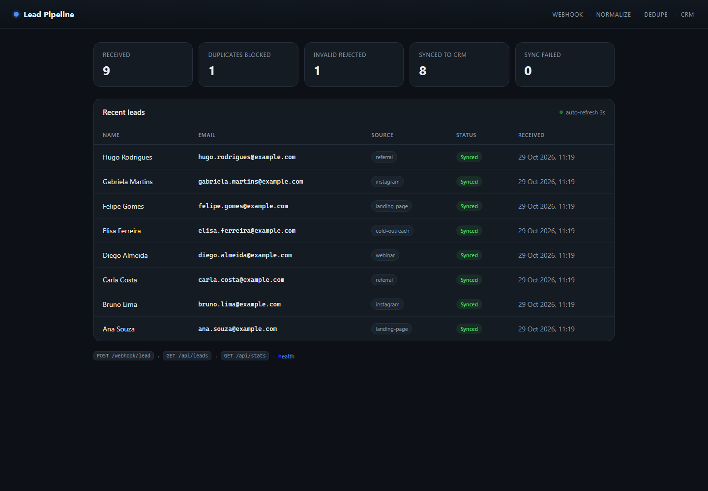
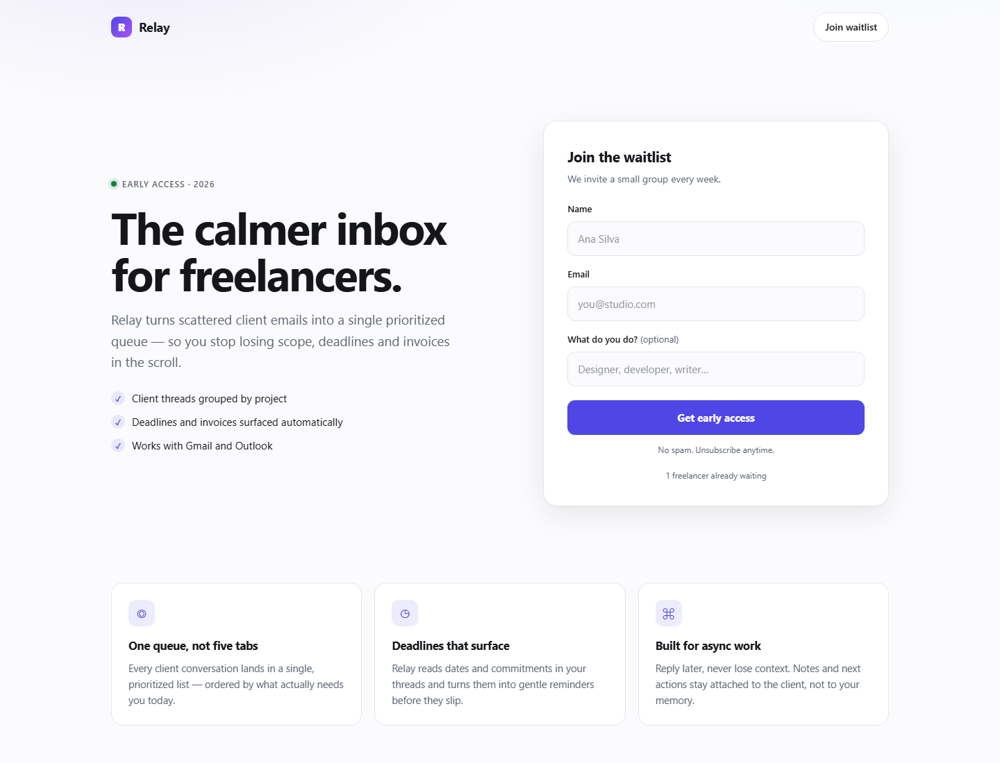

# Portfólio — Automação & Integrações

Dois projetos prontos para usar como portfólio em Upwork, Fiverr, Contra e GitHub.
Ambos rodam com **Node.js puro, zero dependências** — nada de `npm install`, nada para quebrar.

| Projeto | O que prova | Porta |
|---|---|---|
| [`automation-pipeline/`](./automation-pipeline) | Webhook, validação, deduplicação, retry com backoff, persistência atômica, dashboard | 4310 |
| [`landing-form/`](./landing-form) | Landing page responsiva, formulário validado no servidor, anti-spam, rate limit, export CSV | 4320 |

## Demos ao vivo

| Projeto | URL |
|---|---|
| Automation Pipeline (dashboard) | <https://automation-pipeline-2013.onrender.com> |
| Landing Page (formulário) | <https://landing-form-9ebp.onrender.com> |

> Plano free do Render: o serviço dorme após 15 min de inatividade — a primeira visita pode levar ~30 s.

**Dashboard do pipeline**


**Landing page com formulário**


## Rodar

```bash
# Terminal 1 — pipeline
node automation-pipeline/src/server.js

# Terminal 2 — enviar dados de exemplo
node automation-pipeline/scripts/seed.js

# Terminal 3 — landing page
node landing-form/server.js
```

- Dashboard: http://localhost:4310
- Landing: http://localhost:4320

## Por que estes dois

Eles cobrem as duas dores que mais aparecem em anúncios de freelance:

1. **"Meus dados não chegam / se perdem / duplicam"** → `automation-pipeline`
2. **"Minha página não captura lead de verdade"** → `landing-form`

Nenhum é um clone de tutorial: ambos têm tratamento de erro, validação e documentação em inglês — que é o que separa portfólio de "projeto de curso".

## Deploy

Publicado no **Render** com o [`render.yaml`](./render.yaml): dois Web Services gratuitos que leem `PORT` do ambiente.

Para publicar uma cópia sua:
1. Faça um fork do repositório
2. Crie uma conta em [render.com](https://render.com) e conecte o GitHub
3. **New + → Blueprint** → selecione o repositório → **Apply**

> No plano free o serviço dorme após 15 min de inatividade (primeira visita ~30 s) e o disco é efêmero — os dados de `data/` resetam a cada deploy.

Coloque o link no topo do perfil do Upwork. Cliente que vê funcionando contrata muito mais rápido.

## Antes de mostrar

- [ ] Troque `Relay` pelo nome que você quiser (ou mantenha — é uma demo)
- [ ] Tire 2 prints: dashboard com dados e a landing no celular
- [ ] Leia o README de cada projeto — você precisa saber explicar cada decisão
- [ ] Apague `data/*.json` e `data/*.csv` antes de publicar (já está no `.gitignore`)

## O que eu ainda posso construir com você

- Testes automatizados com `node:test`
- Versão com Postgres/SQLite
- Um terceiro projeto (ex.: bot de WhatsApp ou scraper)
- Página de portfólio que lista os três
