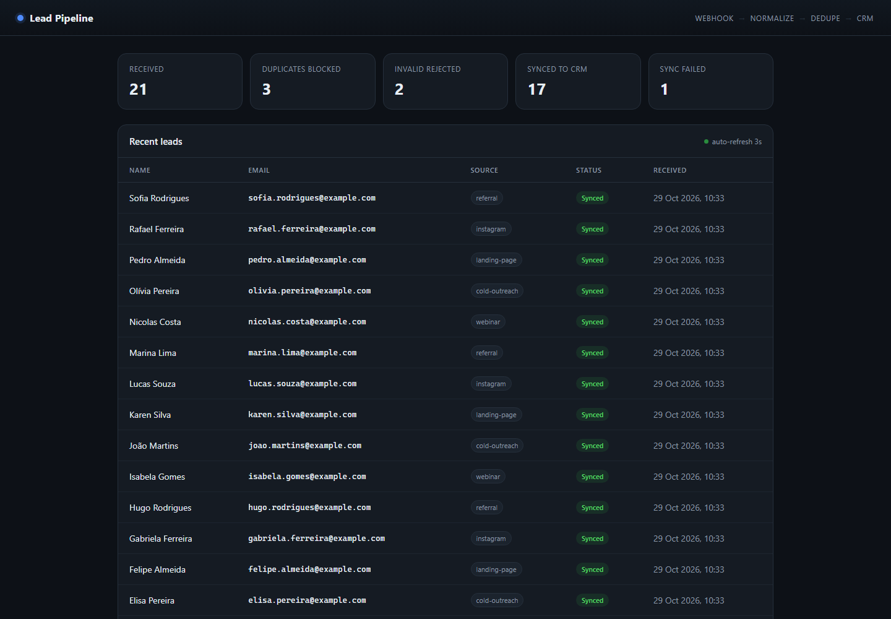
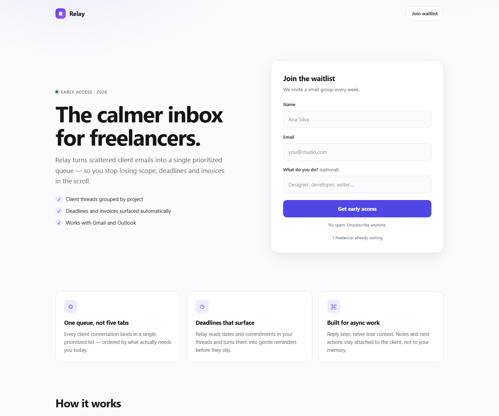

# Portfólio — Automação & Integrações

Dois projetos prontos para usar como portfólio em Upwork, Fiverr, Contra e GitHub.
Ambos rodam com **Node.js puro, zero dependências** — nada de `npm install`, nada para quebrar.

| Projeto | O que prova | Porta |
|---|---|---|
| [`automation-pipeline/`](./automation-pipeline) | Webhook, validação, deduplicação, retry com backoff, persistência atômica, dashboard | 4310 |
| [`landing-form/`](./landing-form) | Landing page responsiva, formulário validado no servidor, anti-spam, rate limit, export CSV | 4320 |

## Preview

**Dashboard do pipeline** (dados de exemplo já carregados)


**Landing page com formulário**


## Rodar

```bash
# Terminal 1 — pipeline
node automation-pipeline/src/server.js

# Terminal 2 — enviar dados de exemplo
node automation-pipeline/scripts/seed.js

# Terminal 3 — landing page
node landing-form/server.js
```

- Dashboard: http://localhost:4310
- Landing: http://localhost:4320

## Por que estes dois

Eles cobrem as duas dores que mais aparecem em anúncios de freelance:

1. **"Meus dados não chegam / se perdem / duplicam"** → `automation-pipeline`
2. **"Minha página não captura lead de verdade"** → `landing-form`

Nenhum é um clone de tutorial: ambos têm tratamento de erro, validação e documentação em inglês — que é o que separa portfólio de "projeto de curso".

## Publicar (próximos passos)

O Git não está instalado nesta máquina. Duas opções:

**A) Instalar Git e subir para o GitHub**
1. Instale o [Git para Windows](https://git-scm.com/download/win)
2. Crie um repositório no GitHub chamado `portfolio`
3. Na pasta `C:\dev\portfolio`:
   ```bash
   git init
   git add .
   git commit -m "feat: automation pipeline and landing form"
   git branch -M main
   git remote add origin https://github.com/Luizwarm/portfolio.git
   git push -u origin main
   ```

**B) Sem Git** — use "Add file → Upload files" no GitHub, arrastando as pastas.

**Demo ao vivo (grande diferencial):** publique qualquer um dos dois no [Render](https://render.com) ou [Railway](https://railway.app) como *Web Service*:
- Build command: *(vazio)*
- Start command: `node automation-pipeline/src/server.js` (ou `node landing-form/server.js`)
- O `PORT` já é lido de `process.env.PORT`.

Coloque o link no topo do perfil do Upwork. Cliente que vê funcionando contrata muito mais rápido.

## Antes de mostrar

- [ ] Troque `Relay` pelo nome que você quiser (ou mantenha — é uma demo)
- [ ] Tire 2 prints: dashboard com dados e a landing no celular
- [ ] Leia o README de cada projeto — você precisa saber explicar cada decisão
- [ ] Apague `data/*.json` e `data/*.csv` antes de publicar (já está no `.gitignore`)

## O que eu ainda posso construir com você

- Testes automatizados com `node:test`
- Versão com Postgres/SQLite
- Um terceiro projeto (ex.: bot de WhatsApp ou scraper)
- Página de portfólio que lista os três
